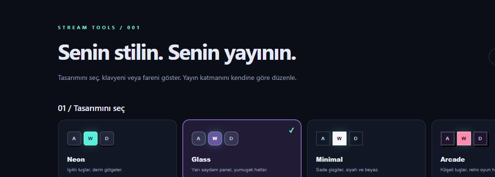

# NeonKeys

[Türkçe](#türkçe) · [English](#english)



## Türkçe

**Windows üzerinde OBS Studio için taşınabilir klavye ve fare göstergesi.**

Kick, Twitch, YouTube ve OBS’nin desteklediği diğer platformlardaki Valorant yayınları için hazırlanmıştır. Bastığın tuşları ve fare tıklamalarını şeffaf bir Tarayıcı Kaynağı üzerinden gösterir. OBS eklentisi, Python kurulumu, hesap veya harici sunucu gerektirmez.

**[NeonKeys.exe indir](https://github.com/emrhn034/neonkeys/releases/download/v0.1.0/NeonKeys.exe)** · **[Sürüm ve ZIP paketi](https://github.com/emrhn034/neonkeys/releases/tag/v0.1.0)**

### Özellikler

- Dört tasarım: **Neon**, **Glass**, **Minimal** ve **Arcade**.
- Yalnızca klavye, yalnızca fare veya ikisini birlikte gösterme.
- Neon, Glass ve Arcade için üç renk paleti; Minimal için siyah-beyaz görünüm.
- Yayıncı adı, canlı önizleme ve animasyonlu tasarım demosu.
- Tasarım, cihaz, renk ve adı içeren OBS adresini kopyalama.
- Panel ve tasarımların içine gömüldüğü tek EXE dosyası.
- Sistem tepsisinden paneli açma, gösterimi duraklatma, varsayılan OBS adresini kopyalama ve çıkış.
- Tuş geçmişi, analiz takibi veya harici girdi sunucusu bulunmaz.

### Başlangıç ve OBS kurulumu

1. **Releases** bölümünden `NeonKeys.exe` indir veya aşağıdaki adımlarla kaynak kodundan derle.
2. Uygulamayı **klavye, fare ve OBS’nin bulunduğu Windows bilgisayarında** çalıştır.
3. Tarayıcıda açılan panelden tasarım ve cihaz seç, ardından **Adresi kopyala** düğmesine bas.
4. OBS → **Kaynaklar → + → Tarayıcı** ekle. **Yerel dosya** kapalı olsun; kopyaladığın adresi URL alanına yapıştır.
5. Panelde gösterilen genişlik ve yüksekliği gir, FPS değerini **60** yap ve kaynağı oyun görüntüsünün üstüne yerleştir.
6. NeonKeys sistem tepsisinde açık kalsın. Tarayıcı panelini kapatabilirsin.

| Cihaz | Genişlik | Yükseklik |
| --- | ---: | ---: |
| Klavye + fare | 560 | 400 |
| Yalnızca klavye | 460 | 400 |
| Yalnızca fare | 260 | 360 |

Panel: `http://127.0.0.1:47831/`

Varsayılan OBS kaynağı: `http://127.0.0.1:47831/overlay`

`127.0.0.1`, **adresi açan kişinin kendi bilgisayarıdır**. Her yayıncı kendi kopyasını çalıştırır ve yalnızca kendi tuşlarını görür. Diğer uygulamalar arka plandayken tuşları göstermek için yerel NeonKeys uygulaması açık kalmalıdır. Bu sürüm iki bilgisayarlı yayın kurulumlarını desteklemez.

Tasarımı veya cihazı değiştirdiğinde yeni adresi OBS’ye yapıştır ve kaynak ölçülerini güncelle. Panel tercihleri o tarayıcının yerel depolamasında saklanır. Animasyonlu demo yalnızca önizlemede çalışır; kopyalanan OBS adresi gerçek girdiyi gösterir.

### Windows gereksinimleri

- Windows 10 veya Windows 11 ve .NET Framework 4.x; genellikle Windows ile birlikte gelir.
- Tarayıcı Kaynağı desteği bulunan OBS Studio.
- Yönetici izni istenmez.
- EXE dijital olarak imzalı değildir. Kodu inceleyip kendin derleyebilirsin.

Uygulama arayüzü şu anda Türkçedir. Tuş açıklamaları varsayılan Valorant atamalarına göredir; oyun içindeki özel atamalar açıklamaları otomatik değiştirmez.

### Kaynak kodundan derleme

Proje klasöründe PowerShell açıp çalıştır:

```powershell
.\build.ps1
```

Üretilen dosyalar:

```text
dist/NeonKeys.exe
dist/NeonKeys.zip
dist/SHA256SUMS.txt
```

Betik, .NET Framework ile gelen C# derleyicisini kullanır. HTML dosyaları derleme sırasında EXE’ye gömülür. Paket indirmek veya API anahtarı eklemek gerekmez.

İsteğe bağlı çalışma kontrolü, tek başına EXE’yi başlatır; gömülü paneli, göstergeyi, olay akışını ve yerel kaynak kısıtlamasını doğrular, ardından kendi başlattığı işlemi kapatır:

```powershell
.\scripts\smoke.ps1
```

Bu kontrolü çalıştırmadan önce açık NeonKeys kopyasını kapat. GitHub Actions, gönderilen değişikliklerde ve pull request’lerde derleme ve çalışma kontrolünü yürütür. `main` dalındaki başarılı derleme, `VERSION` dosyasındaki sürüm henüz yayımlanmamışsa EXE, ZIP ve SHA-256 özetleriyle yayımlar. Önceden yayımlanan sürümler değiştirilmez. `v*` etiketi göndermek de o etiket için sürüm oluşturur.

### Girdi ve gizlilik

Uygulama, Windows’un `GetAsyncKeyState` API’siyle gösterilen tuşlardan oluşan sabit bir listeyi kontrol eder. Fare düğmelerini okur; fare hareketini ve tekerlek kaydırmasını izlemez. Girdi üretmez, oyunu değiştirmez ve oyun işlemine bağlanmaz.

O anda basılı tuşlar, Server-Sent Events üzerinden bu bilgisayardaki tarayıcı kaynaklarına iletilir. HTTP sunucusu yalnızca IPv4 yerel döngü adresini dinler ve ilgisiz Host/Origin başlıklarını reddeder. Tuş durumu bellekte tutulur, diske yazılmaz. Yayında özel bilgi yazmadan önce sistem tepsisinden gösterimi duraklat.

### Bilinen sınırlamalar

- Valorant/Vanguard davranışı **aktif bir oyunda henüz doğrulanmamıştır**. Hile önleme sistemi sertifikası veya uyumluluk garantisi verilmez.
- Klavye görünümü, WASD ve Valorant odaklı küçük bir düzendir; tam klavye değildir.
- Girdi aralıklarla okunduğundan iki okuma arasına denk gelen çok kısa basışlar kaçabilir.
- `47831` bağlantı noktası boş olmalıdır. Her Windows oturumunda tek NeonKeys kopyası çalışır.
- Bu ilk sürümün küçük yerel HTTP sunucusu kişisel yayın kullanımı için tasarlanmıştır.

### Katkıda bulunma ve lisans

Hata bildirimleri, çeviriler, yeni tasarımlar ve pull request’ler açıktır. Ayrıntılar için [CONTRIBUTING.md](CONTRIBUTING.md) dosyasına bak. Proje [MIT lisansıyla](LICENSE) açık kaynaktır.

---

## English

**A portable keyboard and mouse overlay for OBS Studio on Windows.**

Built for Valorant streams on Kick, Twitch, YouTube, or any platform supported by OBS. Show your current key presses and mouse clicks with a transparent Browser Source. No OBS plugin, Python installation, account, or hosted server is required.

**[Download NeonKeys.exe](https://github.com/emrhn034/neonkeys/releases/download/v0.1.0/NeonKeys.exe)** · **[Release and ZIP package](https://github.com/emrhn034/neonkeys/releases/tag/v0.1.0)**

### Features

- Four designs: **Neon**, **Glass**, **Minimal**, and **Arcade**.
- Show keyboard only, mouse only, or both.
- Three color palettes for Neon, Glass, and Arcade; monochrome Minimal.
- Custom streamer name, live preview, and animated preview demo.
- Copy an OBS URL containing your selected design, device, colors, and name.
- Single executable with the panel and overlay embedded inside it.
- System tray controls to open the panel, pause input display, copy the default OBS URL, or quit.
- No input history, analytics, or external input server.

### Get started

1. Download `NeonKeys.exe` from this repository's **Releases**, or build it below.
2. Run it on the **same Windows computer as your keyboard, mouse, and OBS**.
3. In the browser panel, choose a design and device, then click **Adresi kopyala**.
4. In OBS, add **Sources → + → Browser**. Leave **Local file** unchecked and paste the copied URL.
5. Set the width and height shown in the panel, use **60 FPS**, and place the source above your game capture.
6. Keep NeonKeys running in the tray. You may close the browser panel.

| Device | Width | Height |
| --- | ---: | ---: |
| Keyboard + mouse | 560 | 400 |
| Keyboard only | 460 | 400 |
| Mouse only | 260 | 360 |

Panel: `http://127.0.0.1:47831/`

Default OBS source: `http://127.0.0.1:47831/overlay`

`127.0.0.1` means **the computer opening the address**. Every streamer runs their own copy and sees only their own input. This is a local companion app, not a hosted page that can read keyboard input from other applications by itself. Two-computer streaming setups are not supported by this version.

When changing a design or device, copy the new URL into OBS and update its source dimensions. The panel remembers preferences in that browser's local storage. The animated demo applies only to the preview; the copied OBS URL uses real input.

### Windows requirements

- Windows 10 or Windows 11 with .NET Framework 4.x (normally included).
- OBS Studio with Browser Source support.
- No administrator permission is requested.
- The executable is unsigned. Build from source if you prefer to inspect it yourself.

The UI is currently Turkish. The ability captions match default Valorant bindings; custom in-game bindings do not change the captions automatically.

### Build from source

Open PowerShell in the repository folder and run:

```powershell
.\build.ps1
```

Outputs:

```text
dist/NeonKeys.exe
dist/NeonKeys.zip
dist/SHA256SUMS.txt
```

The script uses the C# compiler included with .NET Framework. The HTML files are embedded at compile time. No package downloads or API keys are needed.

An optional integration smoke check starts the standalone executable, verifies the embedded panel, overlay, event stream, and local origin restriction, then stops its own process:

```powershell
.\scripts\smoke.ps1
```

Close an existing NeonKeys instance before running that check. GitHub Actions runs the build and smoke check for pushes and pull requests. A successful push to `main` publishes the version in `VERSION` if it has not already been released. Existing version releases are left unchanged. Pushing a `v*` tag also builds and publishes that tagged release with the executable, ZIP, and checksums.

### Input and privacy

The app polls a fixed list of displayed keys using the Windows `GetAsyncKeyState` API. It reads mouse button presses, not mouse movement or wheel scrolling. It does not inject input, modify the game, or attach to the game process.

Current pressed-key state is sent to local browser sources using Server-Sent Events. The HTTP server listens only on IPv4 loopback and rejects unrelated Host/Origin headers. Pressed-key state is held in memory and is not written to disk. Pause display from the tray before entering private information on stream.

### Known limits

- Valorant/Vanguard behavior has **not been verified in an active game**. This project does not promise anti-cheat certification or compatibility.
- Keyboard layout is a compact WASD/Valorant layout, not a full keyboard.
- Input is sampled, so extremely short taps between samples may be missed.
- Port `47831` must be available. Only one NeonKeys instance runs per Windows session.
- This initial version uses a small local HTTP server intended for personal streaming workloads.

### Contributing

Bug reports, translations, new designs, and pull requests are welcome. See [CONTRIBUTING.md](CONTRIBUTING.md). Licensed under the [MIT License](LICENSE).
